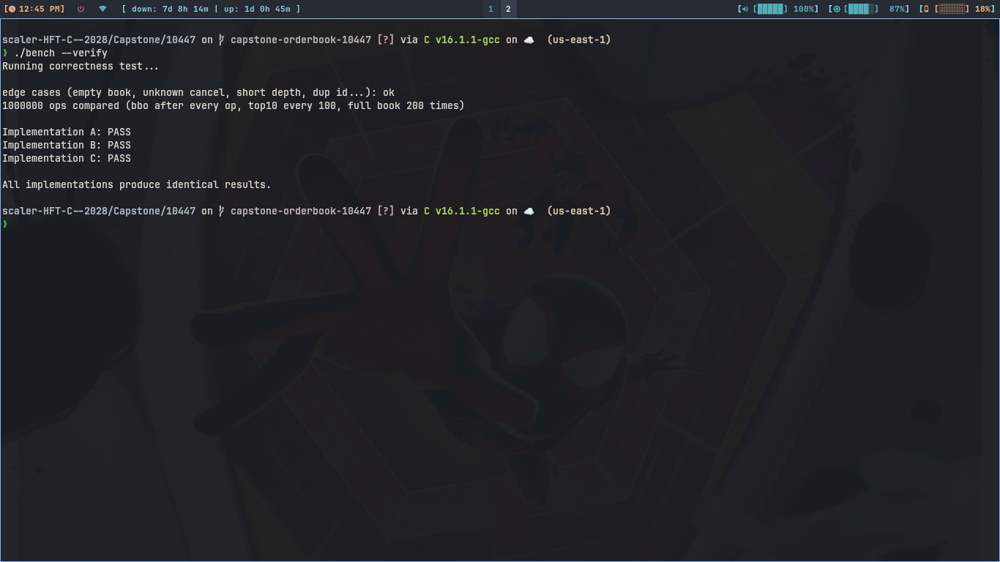
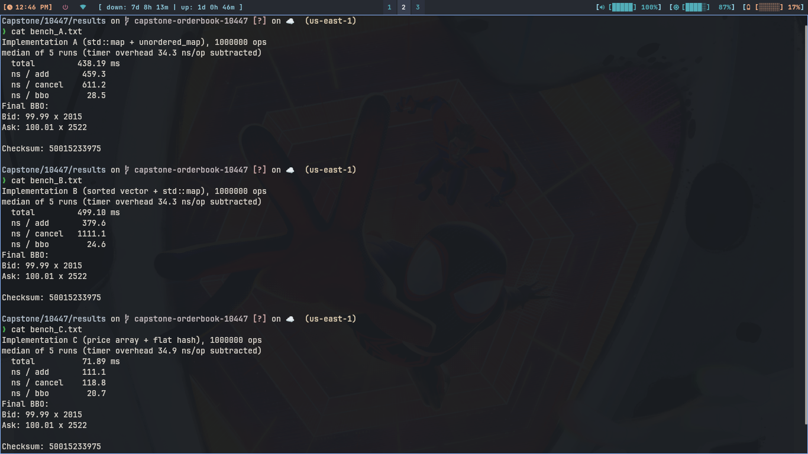
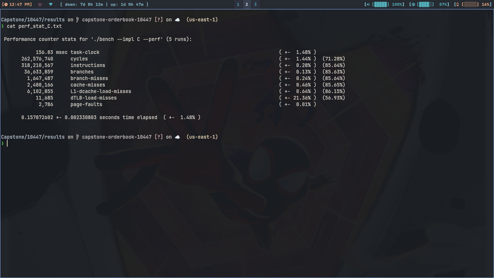
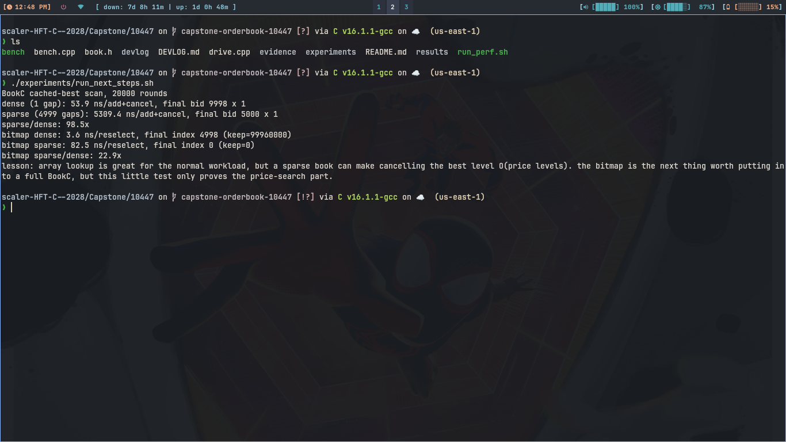

# Capstone: low latency order book

email: "shah.24bcs10447@sst.scaler.com"
roll_no: "10447"

## build and run
```
g++ -std=c++17 -O2 -o bench bench.cpp

./bench --verify              # correctness: all 3 books vs each other
./bench --impl A              # 5 runs, prints the median (same for B and C)
./bench --impl A --perf       # one untimed run, this is what perf stat / perf record use
./run_perf.sh                 # does everything above + perf, writes to results/
```
Files: `book.h` (the 3 books), `bench.cpp` (workload + verify + bench), `run_perf.sh`,
`results/` (raw output of my run), `DEVLOG.md` + `devlog/` (how BookC got built, with the bugs on the way).
No threads, std lib only, compiles with -O2 (`run_perf.sh` adds `-g -fno-omit-frame-pointer` for readable perf stacks, codegen is the same).

There is also `experiments/run_current_machine.sh`. It is the less-clean notebook part:
machine snapshot, 10k / 100k / 1M runs, a bad-command failure, and a perf smoke test.
I added it because one final number table does not show what this laptop can and cannot
handle. `DEVLOG.md` has the mistakes that led to C; it also says clearly which old
scratch versions I did not keep, so nobody has to take those old timings on faith.

My current-machine scaling check came out like this (three runs each, just a check and
not a replacement for the required five-run table below):

| ops | A | B | C |
|---:|---:|---:|---:|
| 10k | 3.31 ms | 4.55 ms | 0.71 ms |
| 100k | 54.12 ms | 52.23 ms | 6.58 ms |
| 1M | 488.28 ms | 588.21 ms | 98.36 ms |

The raw files are under `results/current_machine/`. The exact totals move around when
the laptop is busy, but the shape did not: once the book gets big enough to pressure
the tiny cache, C pulls away and B's cancel path becomes painful.

## screenshot proof

These are screenshots from the actual terminal runs. The raw text files in `results/`
are the source of truth if any number is hard to read here.

correctness check:



five-run benchmark medians:



perf run for BookC:



sparse-level failure case and bitmap follow-up:



## interface changes
- prices are **integer ticks** (100.01 -> 10001) instead of `double`. `Level{int tick; long qty}`, `BBO{... int bid_tick ...}`. bench prints them back as `99.99`.
- `add_order(id, side, tick, qty)`: out of range tick, `qty <= 0` or an already used id is silently ignored.
- rest is as in the spec: `cancel_order` returns false for unknown / already cancelled ids, depth bigger than the book returns what's there, empty book gives `has_bid = has_ask = false`.
- no matching, no trades (the spec says resting book only).

## the 3 designs
L = price levels (max 5000 per side), N = live orders.

| | A | B | C (mine) |
|---|---|---|---|
| price levels | `std::map<int,long>` per side (rb tree) | sorted `std::vector<Level>` per side, best at the back | plain arrays `long bq[5000], aq[5000]` indexed by tick |
| orders (id lookup) | `unordered_map<id, Ord>` | `std::map<id, Ord>` (rb tree) | own flat open addressing hash (linear probing + tombstones), 2^20 slots preallocated |
| best bid/ask | `begin()` of the map | `back()` of the vector | cached index, rescan to the next non empty level when the best one empties |
| cancel: find the order | hash lookup, then map find on its level | tree find on the id, binary search on its level | hash probe, then direct array index |

| op | A | B | C |
|---|---|---|---|
| add_order | O(log L) avg | O(log N + log L), O(L) when a new level is inserted (vector shift) | O(1) avg |
| cancel_order | O(log L) avg | O(log N + log L), O(L) when a level empties | O(1) avg, O(L) worst when the best level empties |
| get_bbo | O(1) | O(1) | O(1) |
| get_bids / get_asks(d) | O(d) | O(d) | O(d + empty gaps), worst O(L) |

## correctness
`./bench --verify` runs the same 1M op workload through all 3. After every op it compares the cancel result and the BBO, every 100 ops the top 10 levels (as in the benchmark), and every 5000 ops the whole book. It also checks that total qty in the book == sum of live order qty, and runs hand written edge cases (empty book, unknown cancel, double cancel, depth bigger than the book, out of range price, duplicate id). Majority vote: the odd one out gets FAIL.
Mutation check: deliberately breaking B or C makes verify fail and blame the right one. Also ran under ASan + UBSan (clean). Also built with `-Wall -Wextra -Wpedantic`, no warnings.
```
Running correctness test...

edge cases (empty book, unknown cancel, short depth, dup id...): ok
1000000 ops compared (bbo after every op, top10 every 100, full book 200 times)

Implementation A: PASS
Implementation B: PASS
Implementation C: PASS

All implementations produce identical results.
```

## test machine
Intel Core i3-4005U @ 1.7 GHz (Haswell, 2 cores / 4 threads, no turbo, 3 MB L3), 4 GB RAM, Arch Linux (kernel 7.1.5-arch1-2), GCC 16.1.1, `-O2`.
Power: <plugged in / battery>

## workload
1M ops, `mt19937(42)`, built once before timing so all 3 get the identical sequence: ~70% add / ~20% cancel (always a live order) / ~10% bbo, plus `get_bids(10)` + `get_asks(10)` every 100 ops. 50/50 buy/sell, qty 1..100, uniform random tick inside the side's band. About 500k orders are live at the end.
Timing with `steady_clock`. Each run does one pass timing the whole loop (total) and a second pass with a clock pair around every op (ns/add, ns/cancel, ns/bbo). The cost of an empty clock pair (about 34 ns here) is measured and subtracted, so the ~20-30 ns bbo numbers are close to the noise floor. Median of 5. Final BBO + checksum are printed (checksum is identical for A, B and C: 50015233975).

## results
I ran the whole `run_perf.sh` twice, the timings agreed within about 5%. Numbers below are the second run. IPC and branch-miss % are computed from the `perf stat` counts.

| Metric | A | B | C |
|---|---:|---:|---:|
| Total time (ms) | 438.19 | 499.10 | **71.89** |
| ns / add | 459.3 | 379.6 | **111.1** |
| ns / cancel | 611.2 | 1111.1 | **118.8** |
| ns / BBO | 28.5 | 24.6 | 20.7 (all three ~ noise) |
| IPC | 0.67 | 0.87 | **1.21** |
| Branch misses (%) | 7.42 | 6.46 | **4.50** |
| branch-misses (count) | 9,091,194 | 12,753,289 | 1,647,487 |
| L1-dcache-load-misses | 24,654,564 | 30,836,451 | **6,102,855** |
| Cache misses | 4,282,160 | 4,836,056 | **2,480,166** |
| dTLB-load-misses | 2,665,818 | 2,704,039 | **11,685** |
| Page faults | 8,526 | 10,100 | **2,786** |

All 9 counters were available. Multiplexing: the 9 events don't fit in the PMU at once (see the percentages in brackets in the raw output), so `perf` scales the counts, treat them as estimates.

**Important caveat on the perf numbers:** `perf stat` measures the whole process, which includes building the 1M op workload (RNG + vector). That part is identical for A, B and C. In `perf record`, `make_workload` is 35.6% of C's samples (about 55 ms of its 157 ms), but only a small slice of A and B, so C's counters are diluted by it and the real gap between C and the others is *bigger* than the table shows. The `ns/op` numbers and total time above are measured inside the benchmark and do not include workload generation.

Raw `perf stat -r 5` output (`results/perf_stat_*.txt`):
```
A:  Performance counter stats for './bench --impl A --perf' (5 runs):
            610.27 msec task-clock                                                              ( +-  2.83% )
     1,022,092,257      cycles                                                                  ( +-  2.75% )  (71.23%)
       687,434,307      instructions                                                            ( +-  0.21% )  (85.63%)
       122,501,456      branches                                                                ( +-  0.27% )  (85.77%)
         9,091,194      branch-misses                                                           ( +-  0.13% )  (85.77%)
         4,282,160      cache-misses                                                            ( +-  3.91% )  (85.77%)
        24,654,564      L1-dcache-load-misses                                                   ( +-  0.49% )  (85.77%)
         2,665,818      dTLB-load-misses                                                        ( +-  1.14% )  (56.93%)
             8,526      page-faults                                                             ( +-  2.93% )
       0.614308313 +- 0.017816321 seconds time elapsed  ( +-  2.90% )

B:  Performance counter stats for './bench --impl B --perf' (5 runs):
            675.65 msec task-clock                                                              ( +-  0.48% )
     1,131,543,266      cycles                                                                  ( +-  0.46% )  (71.30%)
       982,362,603      instructions                                                            ( +-  0.05% )  (85.68%)
       197,405,775      branches                                                                ( +-  0.02% )  (85.76%)
        12,753,289      branch-misses                                                           ( +-  0.05% )  (85.76%)
         4,836,056      cache-misses                                                            ( +-  1.02% )  (85.77%)
        30,836,451      L1-dcache-load-misses                                                   ( +-  0.18% )  (85.75%)
         2,704,039      dTLB-load-misses                                                        ( +-  0.49% )  (56.96%)
            10,100      page-faults                                                             ( +-  0.00% )
       0.680091529 +- 0.003359732 seconds time elapsed  ( +-  0.49% )

C:  Performance counter stats for './bench --impl C --perf' (5 runs):
            156.83 msec task-clock                                                              ( +-  1.48% )
       262,576,740      cycles                                                                  ( +-  1.44% )  (71.28%)
       318,210,567      instructions                                                            ( +-  0.28% )  (85.64%)
        36,633,859      branches                                                                ( +-  0.13% )  (85.63%)
         1,647,487      branch-misses                                                           ( +-  0.24% )  (85.64%)
         2,480,166      cache-misses                                                            ( +-  0.46% )  (85.65%)
         6,102,855      L1-dcache-load-misses                                                   ( +-  0.64% )  (86.15%)
            11,685      dTLB-load-misses                                                        ( +- 21.36% )  (56.93%)
             2,786      page-faults                                                             ( +-  0.01% )
       0.157872602 +- 0.002330803 seconds time elapsed  ( +-  1.48% )
```

`perf record -g` (full reports in `results/perf_report_*.txt`, first 80 lines only):
- **A:** 36.7% in `BookA::add_order`, and about 25% of the total is the `std::map` descent inside `operator[]` (`_M_lower_bound` / `_S_right`, four call stacks add up to ~25.6%). The hash side shows up as the `_Mod_range_hashing` modulo.
- **B:** 25.7% in the inlined `run<BookB>`, of which 17.4% is `_Rb_tree::find` on the order id inside `cancel_order`, and another 18.9% is `std::__lower_bound` over the `Level` vector.
- **C:** 35.6% is `make_workload` (not the book!), 28.4% is `BookC::add_order`, and 20.4% of that is the inlined `insert` (the probe into the 32 MB table).

## analysis

**Which is fastest (11.1).** C wins add and cancel by a lot. Total 71.9 ms vs 438 ms (A) and 499 ms (B), 6.1x and 6.9x faster. add: 111 ns vs 459 (A, 4.1x) and 380 (B, 3.4x). cancel: 119 ns vs 611 (A, 5.1x) and 1111 (B, 9.4x). For get_bbo all three are within 8 ns (20.7 / 24.6 / 28.5 ns) after subtracting about 34 ns of timer cost, which is the same size as the noise, so I won't call a winner there (all three are O(1): `begin()`, `back()`, cached index). C is fastest because an add is one hash insert plus `bq[i] += qty`, and a cancel is one hash probe plus an array index, with no malloc and no tree walk anywhere. B's cancel is the slowest since it first walks an rb-tree of ~500k order nodes (about 19 dependent pointer loads, most missing the 3 MB L3) and then binary searches the level vector; the perf profile agrees (17% + 19% of B's samples are those two things). Interesting: B's add (380 ns) beats A's (459 ns) even though B pays a tree insert for the id. My guess is that A's `std::map` level lookup chases pointers while B's binary search runs over a contiguous 80 KB vector, but I did not test that.

**Branch prediction (11.2).** By count B has the most branch misses (12.75M, it also executes the most branches, 197M vs 122M and 37M), by rate A is worst (7.42%, B 6.46%, C 4.50%). Tree descents (`key < node->key ? left : right`), the binary search in B and walking hash chains in A are all data-dependent branches on random keys, so the predictor is near a coin flip on them. C executes about 3-5x fewer branches in total and the remaining ones (probe loop, side check, "did the best level empty") are mostly predictable. Not all of C's 4.5% is the book though: the benchmark loop itself has a random op-type `switch` (70/20/10) and the workload generator has its own branches, so there is a floor shared by all three.

**Cache (11.3).** B has the most (4.84M cache misses, 30.8M L1 misses), A is close (4.28M / 24.7M), C has about half the cache-misses and a quarter of the L1 misses (2.48M / 6.1M). Both A and B chase pointers: every order is a separate heap node (A: hash node, B: ~64 B rb-tree node), so ~500k live orders is roughly 30 MB scattered over the heap, 10x bigger than the L3. Each lookup is a chain of dependent loads. C's levels are a contiguous array (40 KB per side, scanned sequentially when the best level empties) and its order lookup is a single random probe into a flat table. That probe still misses cache (it is the 20% `insert` hot spot in perf), but it is one miss instead of a chain. I expect fewer L1 misses per instruction too: 19 per 1000 instructions for C vs 31 (B) and 36 (A).

**Page faults (11.4).** B has the most (10,100), then A (8,526), C the fewest (2,786). That is a bit surprising, because C preallocates a 32 MB table and still faults the least. Treating C's 2.8k as the shared baseline (process start + workload), A and B take about 5.7k and 7.3k *extra* faults, roughly 22 MB and 29 MB of small heap nodes touched for the first time in 4 KB pages (my estimate). So A/B's memory grows node by node during the run and every new page is a fault in the hot path, while C pays for its memory in one `assign` at construction. Why C's big allocations cost so few faults (32 MB would be 8k pages at 4 KB each) I think is transparent huge pages, which would also explain C's 11.7k dTLB misses vs 2.7M for A/B. I did not check this (`cat /sys/kernel/mm/transparent_hugepage/enabled`), so treat it as a guess.

**Production choice (11.5).** I would pick C, but not only because it is fastest. Predictability: no malloc/free on the hot path, so no allocator latency spikes or fragmentation, and the order lookup cost doesn't depend on tree depth. Cache/memory: one flat table and two small arrays, fixed 32 MB, which is also the downside, it costs the same with 10 live orders as with 700k, and if the table goes past 70% full (counting tombstones) `rehash()` is a stop-the-world pause, so in production I would size it for the max number of live orders up front and alert instead of growing. Complexity and maintainability are where C is worst: it is the most code and the bugs found while developing it (stale best price, broken probe chains after delete, infinite loop with no rehash, see `DEVLOG.md`) are exactly the kind that hurt in production. I did not preserve the old scratch headers, so those failures are a documented bug diary, not rerunnable source. A is by far the easiest to read and trust since the standard library does the hard parts, and I would fall back to A if nobody on the team could maintain a custom hash table. B is the one I would not ship: slowest cancel, and `vector::insert/erase` is O(L) memmove in the worst case. Also C's worst case is O(L) when the best level empties and it scans for the next one, which matters for a sparse book (here it is dense, ~50 orders per level).

**What I would try next (11.6).**
1. Bitmap of non-empty levels (80 x 64-bit words per side) and `__builtin_ctzll/clzll` to find the next best level instead of scanning.
2. Order ids here are sequential, so a direct-indexed array `id -> slot` (with a fallback for sparse ids) would remove hashing and probing; at least prefetch the slot.
3. Shrink the 32 byte slot to 16 (id + tick as `int16` + qty as `int32` + state) so twice as many fit per cache line.
4. Ask for huge pages explicitly (`madvise` / `MAP_HUGETLB`) instead of hoping for THP, and check if it really is what lowers the page faults/dTLB misses.
5. `get_bids/get_asks` return a `vector` (heap alloc every call); take a caller-provided buffer.
6. Exclude workload generation from `perf stat` (measure a gen-only baseline and subtract, or use `perf stat --delay`) and pin both the bench to one core with `taskset`.
7. If price-time priority becomes a requirement (the notes in the repo hint at it), keep a per-level FIFO of order slots instead of just the aggregate qty.
